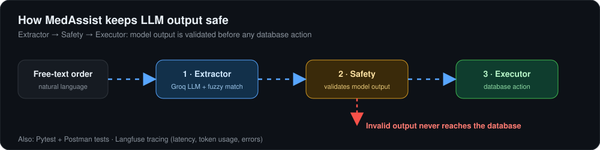

<div align="center">


<br/>

[](https://www.linkedin.com/in/amey-khodke)
[](mailto:ameykhodke430@gmail.com)


</div>

<br/>

> ### *"Ship it. Measure it. Then trust it."*
> I build AI systems that **check themselves**: LLM apps with safety layers, RAG pipelines with measured accuracy, and data products that people can act on. Final-year B.Tech IT at Sanjivani College of Engineering (CGPA 8.9), interned at **Celebal Technologies** and **Godrej Infotech**.

---

## 📊 The Numbers I'm Proud Of


---

## 🧠 How I Build

| | Principle | Where it shows up |
|---|---|---|
| 🛡️ | **Validate before you trust.** An LLM's output is a suggestion, not an instruction. | MedAssist AI puts a dedicated **Safety stage** between the model and the database |
| 📏 | **Measure, don't guess.** If I can't measure it, I can't claim I improved it. | CivicLens AI: tuned retrieval, then re-measured accuracy and latency |
| 🔨 | **Build it from scratch once.** Frameworks make sense after you've felt what they hide. | DocuMind RAG: a full RAG pipeline with no LangChain |
| 🔍 | **Make systems observable.** You can't fix what you can't see. | Langfuse tracing of latency, token usage and errors; Pytest and Postman tests |

---

## 🚀 Featured Projects

### 💊 [MedAssist AI](https://github.com/AmeyKhodke/MedAssist_AI): an LLM pharmacy assistant that doesn't trust the LLM



Free-text medicine orders become **validated** database actions. Also: Gemini Vision prescription OCR, Hindi / Tamil / Marathi support, an admin dashboard with KPI monitoring and refill prediction, and persistent cross-session memory.

       

<br/>

### 🏛️ [CivicLens AI](https://github.com/AmeyKhodke/CIviclens_AI): a RAG copilot for public leaders



Document intelligence, semantic search and meeting summaries over large policy documents, with async FastAPI endpoints for concurrent requests and agentic retrieval workflows.

     

<br/>

<table>
<tr>
<td width="50%" valign="top">

### 📄 [DocuMind RAG](https://github.com/AmeyKhodke/DocuMind_RAG)
**A document Q&A pipeline with no LangChain**

- 📑 Page-aware chunking
- 🔄 Retry logic on LLM calls
- 🗜️ Extractive compression for summaries and key points
- 🌐 Multilingual Q&A: English, Hindi, Marathi

  

</td>
<td width="50%" valign="top">

### ⚡ [Smart-Grid Energy System](https://github.com/AmeyKhodke/Celebal_Excellence_Internship_Data_Science)
**Forecasting and tariff optimization from smart-meter data**

- 🔧 ETL with lag, rolling-window and HDD/CDD features
- 👥 K-Means: 4 consumer behavior archetypes
- 📈 LightGBM / Random Forest 7-day demand forecaster
- 💰 Streamlit Time-of-Use tariff and peak-load simulator

  

</td>
</tr>
</table>

---

## ❓ Questions I Enjoy Answering

<details>
<summary><b>Why put a Safety stage between an LLM and a database?</b></summary>
<br/>
Because a model can produce plausible but wrong output, and in a pharmacy workflow a wrong write is costly. In MedAssist, the Extractor interprets the order, the Safety stage validates it, and only then does the Executor act. The model never gets direct write access.
</details>

<details>
<summary><b>How did you improve CivicLens retrieval?</b></summary>
<br/>
By treating chunking and embedding choice as things to measure. I tuned FAISS index chunking and the embedding model, then re-ran governance document queries. Top-3 accuracy moved from ~65% to ~85%, and average latency from ~1.2s to ~0.7s.
</details>

<details>
<summary><b>Why build DocuMind without LangChain?</b></summary>
<br/>
To understand what the frameworks hide: chunking, retries and compression. Writing page-aware chunking and extractive compression myself made me far better at debugging retrieval problems later.
</details>

---

## 🛠️ Toolbox

<div align="center">


<br/>

<br/>


</div>

**🧠 GenAI:** RAG · LLMs · Prompt Engineering · Transformers · NLP · Agentic AI · LlamaIndex · FAISS · ChromaDB · Langfuse
**📊 Data & BI:** SQL · Pandas · LightGBM · K-Means · Time-Series Forecasting · Power BI · Tableau · Excel
**🧪 Quality & Security:** Pytest · Postman · retrieval benchmarking · LLM security (CLLMSE)

---

## 💼 Experience and Recognition

```text
Jun 2026 – Aug 2026   Data Science Intern            Celebal Technologies
Jan 2026 – Feb 2026   Data Analytics, Cloud & AI     Godrej Infotech
2027 (expected)       B.Tech, Information Technology Sanjivani College of Engineering · CGPA 8.9
```

- 🥇 **National Finalist**, India Innovates Hackathon (Top 1000 of 4000+ teams)
- 🥉 **4th Place**, Hackfusion 3.0 (36-hour hackathon) · State Round Qualifier, Dipex 2025
- 🔐 Certified LLM Security Expert (CLLMSE) · Google Data Analytics Professional Certificate · Machine Learning using Python · Postman API Fundamentals Student Expert
- 🧩 174+ DSA problems solved · 📝 Published: *SwiftCafe: Canteen Food Service Automation* (IJIRSET)

---

## 📈 Activity

<div align="center">


</div>

---

<div align="center">

### 🤝 Building something with LLMs, retrieval or data? Let's talk.

I'm looking for **Data Scientist, AI/ML Engineer and Software Engineer** roles starting 2027.

[](mailto:ameykhodke430@gmail.com)
[](https://www.linkedin.com/in/amey-khodke)

</div>
